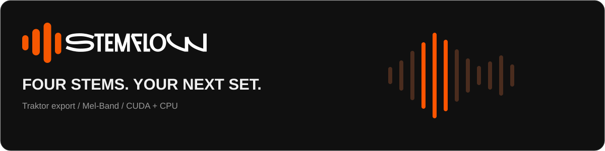

<p align="center"><strong>English</strong> · <a href="README.ru.md">Русский</a></p>

<p align="center">
  
</p>

<p align="center">
  
  
  
  
  
</p>

<p align="center"><strong>One track. Four parts. Ready for your next set.</strong><br>
An open-source desktop stem generator for Traktor Pro 4.</p>

---

## Features

| | |
|---|---|
| **Four stems** | Drums, Bass, Other and Vocals with MelBand 4-stem SYH v2 |
| **CUDA / CPU / Auto** | Auto prefers CUDA and restarts the entire track on CPU if CUDA fails or runs out of VRAM |
| **Playlist processing** | Import files or folders, view artwork, cancel and retry; load the model once per queue |
| **Traktor Stem export** | Original master + four stems, five stereo AAC streams targeting 320 kbps each |
| **Metadata** | Copy supported tags and embedded artwork from the original |
| **Your destination** | Choose and remember a save folder, optionally keep separate WAVs |
| **Source replacement** | Save a Stem beside the source and archive the original after export validation |
| **Desktop interface** | English by default, optional Russian, Roboto and a compact frameless window |

Normalization, compression and limiting are disabled. The master bypasses the
model; the sum of the separated stems may differ from the original.

## Download for Windows

[**Get the Windows alpha release**](https://github.com/Chepuxaa/StemFlow/releases/tag/v1.0.0-alpha.1).
Extract the complete application folder and launch **`StemFlow.exe`**.
Keep `StemFlow-worker.exe` and `_internal` beside it: the worker and CUDA runtime
are required. Python does not need to be installed separately.

First-run setup downloads the model (3.76 GB) and the audio tool (about 31 MB)
directly from their upstream sources, with progress and integrity checks.
Once installed, processing works offline. If the archive has `.001` and `.002`
parts, download both into one folder and open `.001` with [7-Zip](https://www.7-zip.org/).

## Quick start from source

**Tested setup:** Windows, Python 3.14.8 x64, PyTorch CUDA 12.6, RTX 3070 with
8 GB VRAM and 16 GB RAM. CPU processing is supported but substantially slower.
The GUI requires [Microsoft Edge WebView2 Runtime](https://developer.microsoft.com/microsoft-edge/webview2/).

### 1. Install dependencies

Download or clone this repository, then open PowerShell in its directory:

```powershell
py -3.14 -m venv .venv
.\.venv\Scripts\python.exe -m pip install --no-cache-dir -r requirements/app.lock.txt
```

Dependencies stay inside `.venv`. imageio-ffmpeg provides the FFmpeg executable;
a separate FFmpeg installation is not required to run the app.

### 2. Download the model

**The model weights are not included in this Git repository.** Download them once:

```powershell
.\.venv\Scripts\python.exe scripts/download_model.py
```

The script downloads the **SYH v2 checkpoint, approximately 3.76 GB**, directly
from [SYH99999's Hugging Face repository](https://huggingface.co/SYH99999/MelBandRoformer4StemFTLarge).
It uses the pinned revision in `config/model.json` and verifies both file size and
SHA-256 before installing the checkpoint.

- Both source and EXE: `%LOCALAPPDATA%\StemFlow\models\melband-4stem-syh-v2\ver2.ckpt`.
- The model configuration and download manifest are versioned in `config/`.
- An existing checkpoint is verified and reused.
- The GUI checks model integrity at startup and offers an in-app download with progress, speed and cancellation when weights are missing or invalid.
- Once dependencies and weights are installed, track processing needs no network access.

Verify an existing download without downloading anything:

```powershell
.\.venv\Scripts\python.exe scripts/download_model.py --verify-only
```

### 3. Launch

Open **`Start-Stemgen.cmd`**, or run:

```powershell
.\.venv\Scripts\python.exe stemflow.py
```

Optional CUDA check:

```powershell
.\.venv\Scripts\python.exe scripts/check_cuda.py
```

## Workflow

1. Choose a destination on the main page or in **Settings → Traktor export**.
2. Add tracks or a folder.
3. Select **Auto**, **CUDA** or **CPU**, then start the queue.
4. Load the resulting `.stem.mp4` into a Traktor Stem Deck.

The default chunk length is 11 seconds. Select 6 seconds to reduce VRAM usage.
Existing Stem files are never overwritten. Change the UI language in
**Settings → Interface language**; your choice is saved.

### Replace files in their original folder

Choose **Replace in source folder** in Settings. The app validates all five
audio streams and the copied container before archiving the source.

```text
Music/
├── Track.stem.mp4
└── .stemflow-originals/
    └── Track.mp3
```

To restore a source, move it out of `.stemflow-originals`. Backup originals
and existing Stem files are excluded from subsequent imports.

## Command line

```powershell
.\.venv\Scripts\python.exe separate.py "D:\Music\Track.mp3" --seconds 0 --device auto --output-dir "D:\Music\Stems" --discard-wavs
```

`--seconds 0` processes the full track. The CLI keeps WAVs unless you pass
`--discard-wavs`. For full-track source replacement, use `--replace-original`
instead of `--output-dir`.

## Data locations

| Data | Location |
|---|---|
| Settings, queue, reports, GUI cache | `%LOCALAPPDATA%\StemFlow` |
| Scratch audio | `%TEMP%\StemFlow`; cleared on completion or cancellation |
| Finished stems | Your selected destination |
| Retained WAVs | `<track>-stems` beside the finished file |
| Model weights in source mode | `%LOCALAPPDATA%\StemFlow\models\melband-4stem-syh-v2` |
| Model weights in the EXE build | `%LOCALAPPDATA%\StemFlow\models\melband-4stem-syh-v2` |

## Development and Windows EXE

```powershell
.\.venv\Scripts\python.exe scripts/check_repository.py
```

[Contributing](CONTRIBUTING.md) · [Windows build instructions](docs/build.md)

The first **alpha Windows build** has been created and checked on the development
PC: GUI startup, CUDA/CPU separation, Auto fallback without CUDA, queue processing,
model reuse and worker cancellation. It still needs testing on a clean Windows
installation and with more real-world tracks. Download the alpha from
[GitHub Releases](https://github.com/Chepuxaa/StemFlow/releases/tag/v1.0.0-alpha.1).

The bundle contains `StemFlow.exe`, `StemFlow-worker.exe` and a shared `_internal`
directory. Extract and keep the entire folder together; Python is included.
Open `StemFlow.exe`. The application checks the model and offers a download if needed; no separate script is required. `Download-model.cmd` remains an optional CLI alternative.

The binary setup can also be run from PowerShell:

```powershell
.\StemFlow-worker.exe --download-model
.\StemFlow.exe
```

Weights will remain separate from both Git and the EXE bundle.

```text
stemflow.py           GUI / worker entry point
desktop.py           window, queue, artwork and settings
separate.py           track processing and queue protocol
model_runtime.py      model loading and queue cache
ni_stem.py            NI Stem container
audio_metadata.py     artwork and tags
file_output.py        validation and source replacement
app_paths.py          resources, user data and scratch paths
ui/                   HTML, CSS, JS, logo and fonts
config/               model config and pinned download manifest
vendor/msst/          pinned architecture and upstream license
scripts/              download, validation and build tools
packaging/            PyInstaller recipe
```

## License and credits

Developer and designer: **[@Chepuxaa](https://github.com/Chepuxaa)**.

Built with assistance from **OpenAI Codex**.

Original code is [MIT-licensed](LICENSE). Third-party components and model weights
retain their own licenses; see [THIRD_PARTY_NOTICES.md](THIRD_PARTY_NOTICES.md).

Thanks to **SYH99999** for the weights, to
[Music Source Separation Training](https://github.com/ZFTurbo/Music-Source-Separation-Training)
for the architecture, and to the PyTorch, pywebview and Roboto teams.

StemFlow is an independent project and is not affiliated with Native Instruments.
